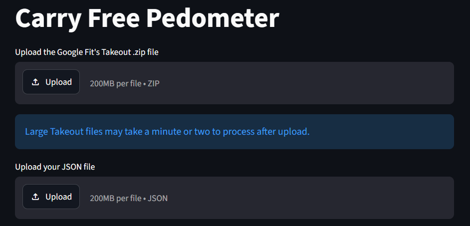
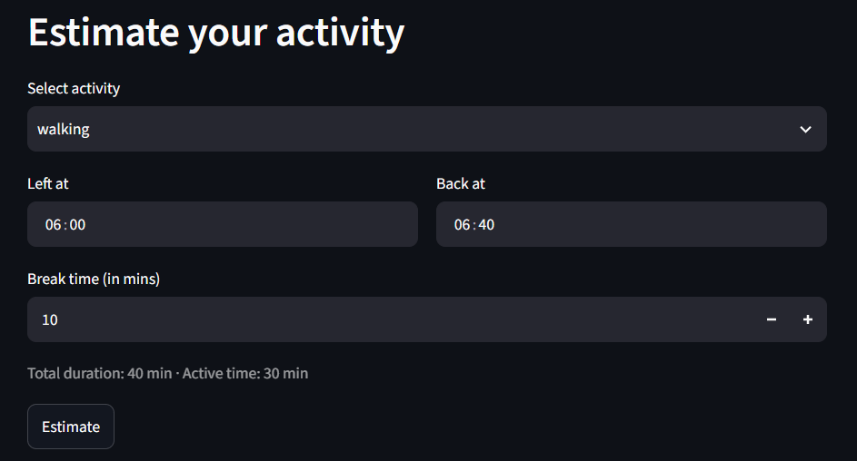
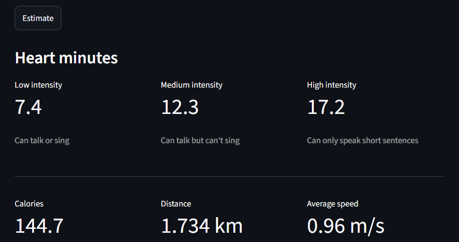

# Carry Free Pedometer
A tool that lets you estimate Google Fit's activity metrics (like heart minutes, calories, distance, and speed ) without carrying your phone or health band around.

[Deployed link](https://carry-free-pedometer.onrender.com/)

## Language Used
- Python 3

## Libraries Used
- NumPy
- Pandas
- Streamlit
- streamlit_local_storage

## How to Run on Your Local Machine

### 1. Clone this Repository
```
git clone https://github.com/imayushfr/carry-free-pedometer.git
```
### 2. Navigate to Cloned Directory
```
cd carry-free-pedometer
```
### 3. Create a Virtual Environment
```
python -m venv venv
```
### 4. Activate the Virtual Environment

**Windows:**
```
venv\Scripts\activate
```
**Linux / macOS:**
```
source venv/bin/activate
```
### 5. Install Dependencies
```
pip install -r requirements.txt
```
### 6. Run the Application
```
streamlit run app.py
```
### 7. Open the Application

Streamlit will display a local URL in your terminal, usually:

```text
http://localhost:8501
```

## How to Use

1. Download your **Google Fit's Takeout** `.zip` file from here: https://takeout.google.com/ (You only need this for the first usage).


2. Upload the `.zip` takeout file to the application. It will create a `.json` file.



3. Upload that `.json` file to the application. It will extract values from the `.json` file and will be saved in the browser's local storage.

4. Estimate your stats by entering **Leaving time**, **Returning  time**, and **breaks** in between.



